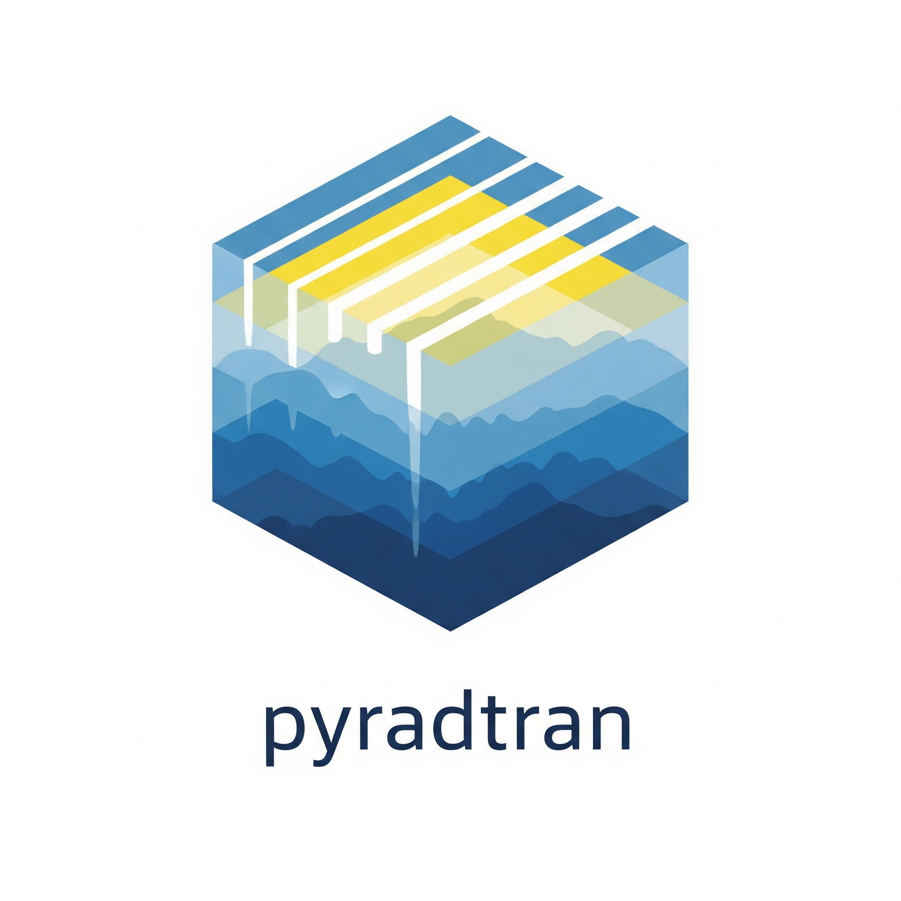

# pyRadtran


[](https://franzflink.github.io/pyRadtran/)
[](https://github.com/FranzFlink/pyRadtran/blob/main/LICENSE)
[](https://github.com/FranzFlink/pyRadtran/actions/workflows/tests.yml)

A Python interface for the [libRadtran](http://www.libradtran.org)
radiative transfer model (`uvspec`): set up, run and analyse solar and
thermal simulations from [xarray](https://xarray.dev) datasets.

- **xarray in, xarray out**: `ds.pyradtran.run()` runs `uvspec` in
  parallel for every point of a dataset and returns a labelled Dataset
- **One parameter mapping**: literals, per-point `Var()` references and
  config overrides go through `params`, validated against the installed
  libRadtran before anything runs
- **Atmospheres and clouds**: standard profiles, IGRA radiosondes, ERA5
  reanalysis; parametric and file-based clouds
- **Post-processing**: instrument-channel convolution, brightness
  temperatures, finite-difference sensitivity kernels
- **Provenance**: every result records the configuration, parameters
  and an annotated uvspec input file

**Documentation: <https://franzflink.github.io/pyRadtran/>**

## Installation

Requirements: Python 3.9+ and a working
[libRadtran](http://www.libradtran.org) installation (built separately).

```bash
git clone https://github.com/FranzFlink/pyRadtran.git
cd pyRadtran
pip install -e .
```

Tell pyRadtran where libRadtran is (written to `~/.pyradtran/config.yaml`):

```python
import pyradtran

pyradtran.save_master_config(
    libradtran_bin="/path/to/libRadtran/bin/uvspec",
    libradtran_data="/path/to/libRadtran/data",
)
```

## Quick start

```python
import pandas as pd
import xarray as xr
import pyradtran                     # registers the .pyradtran accessor
from pyradtran import Var

ds = xr.Dataset(coords={
    "time": pd.date_range("2025-04-04", periods=24, freq="h"),
    "latitude": ("time", [61.0] * 24),
    "longitude": ("time", [22.0] * 24),
})
ds["surface_albedo"] = ("time", [0.2] * 24)

res = ds.pyradtran.run(
    config_path="config/spectral_config.yaml",
    params={
        "albedo": Var("surface_albedo"),                  # per point
        "mol_modify O3": 320.0,                           # every point
        "simulation_defaults.wavelength_nm": [400, 700],  # config override
    },
)
res.edir.sel(wavelength=550, method="nearest").plot()
```

`ds.pyradtran.explain(...)` prints the generated uvspec input file, with
the source of every line, without running anything.

## Citing

If you use pyRadtran, please cite the archived release (Zenodo DOI, see
[`CITATION.cff`](CITATION.cff)) **and libRadtran**, which does the
radiative transfer:

- Emde, C., Buras-Schnell, R., Kylling, A., Mayer, B., Gasteiger, J.,
  Hamann, U., Kylling, J., Richter, B., Pause, C., Dowling, T., and
  Bugliaro, L.: The libRadtran software package for radiative transfer
  calculations (version 2.0.1), Geosci. Model Dev., 9, 1647–1672,
  <https://doi.org/10.5194/gmd-9-1647-2016>, 2016.
- Mayer, B. and Kylling, A.: Technical note: The libRadtran software
  package for radiative transfer calculations – description and examples
  of use, Atmos. Chem. Phys., 5, 1855–1877,
  <https://doi.org/10.5194/acp-5-1855-2005>, 2005.

## License

pyRadtran is released under the [MIT License](LICENSE).

pyRadtran is an independent project. It is not part of libRadtran and is
not affiliated with or endorsed by the libRadtran developers.
libRadtran is distributed under the
[GNU General Public License v2](https://www.libradtran.org/doc/COPYING);
it is not included in this repository or in the pyRadtran package and
must be obtained and installed separately. pyRadtran runs the `uvspec`
executable as a separate program and reads libRadtran's option
descriptions from the local installation at run time.
